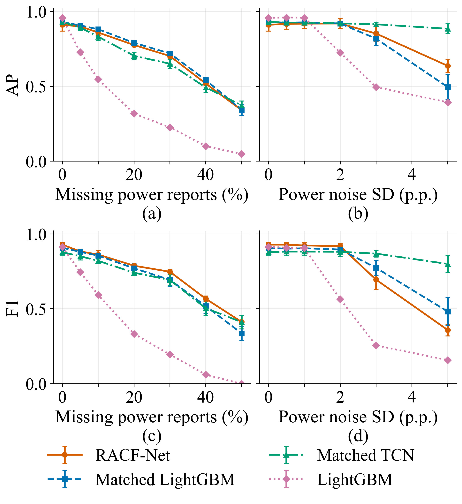
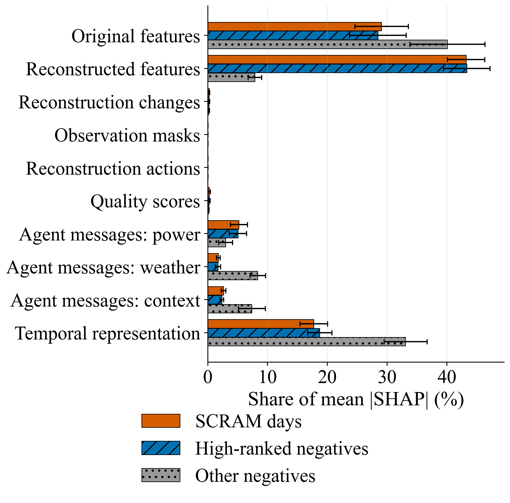
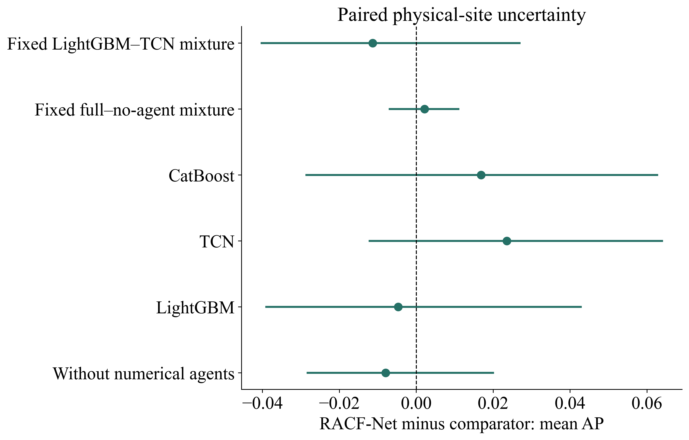

# RACF-Net: Reliability-Aware Cooperative Fusion for Retrospective SCRAM Recognition

Data, code and results of an experimental study on recognising reactor SCRAM events (rapid emergency shutdowns)
at U.S. commercial nuclear power plants from daily operational records. The task is retrospective: for every
reactor and report date, a model decides whether a documented SCRAM occurred on the preceding calendar day.
The repository contains six Jupyter notebooks that cover the complete pipeline, the result tables and all
figures of the study. The raw input data are public and are not redistributed here; the Dataset section lists
the sources and the exact files. The derived reactor-day archive, the split definitions and the event-level
label file are included.

## Overview

The study asks which computational mechanisms make such recognition reliable. It builds an integrated archive
of 242,605 reactor-day records for 2019–2025 from three public U.S. sources, defines a
leakage-controlled protocol with 51 tabular predictors and seven-channel 30-day sequences, and compares a
proposed architecture with 15 reference configurations under one common protocol.

**RACF-Net** (Reliability-Aware Cooperative Fusion Network) combines four elements: original and conditionally
reconstructed observations, numerical agents that exchange expected values between related predictors, a shared
temporal convolutional representation, and a LightGBM classification expert (Figure 2).

<p align="center">
  
</p>

Main findings on the 2023 test cohort (20,333 reactor-days, 42 SCRAM-positive days, 50 sites, three training seeds):

- RACF-Net reaches AP = 0.9103 ± 0.0411, F1 = 0.9285 ± 0.0160 and MCC = 0.9295 ± 0.0152 and misses one of the 42 SCRAM-positive days.
- A plain LightGBM classifier on the 51 predictors has a higher AP (0.9567). No AP advantage of RACF-Net over any
  comparator is supported after Holm correction.
- Among the three primary matched comparisons, the F1 and MCC gains are significant only against the matched
  temporal convolutional network (F1 difference +0.050, 95% CI
  [0.016; 0.085], Holm-adjusted p = 0.027).
- Conditional reconstruction gives a modest numerical benefit. Numerical agents and the exchange between them
  contribute inconsistently, and no component effect is supported after Holm correction.

The results favour reliable power measurements, a strict evaluation protocol and strong baselines over
architectural complexity. The study does not address forecasting of future events or reactor control.

## Dataset

All inputs are public records of three U.S. federal agencies: the Nuclear Regulatory Commission (NRC), the
National Centers for Environmental Information of NOAA, and the Energy Information Administration (EIA). The
files are not copied into this repository. The study used the versions retrieved on 11 October 2026 (the 2026
extension on 12 October 2026).

| Source | Provider | Content used | Period | Files, size | Expected location | Original source |
| :--- | :--- | :--- | :--- | ---: | :--- | :--- |
| Power Reactor Status Reports | NRC | Daily reactor power, per cent of rated power, for every unit | 2019–2025 | 7 yearly text files and a data dictionary, 8.8 MiB | `dataset/Raw/NRC_Power_Status/` | [nrc.gov, power reactor status reports](https://www.nrc.gov/documents-reports/document-collections/events-reports-associated-with/power-reactor-status-reports/) |
| SCRAM event notification data set | NRC | Curated register of SCRAM events: date, docket, automatic or manual actuation, retraction flag | 2019–2025 | 1 workbook and a data dictionary | `dataset/Raw/NRC_Scrams/` | [nrc.gov, data set (xlsx)](https://www.nrc.gov/sites/default/files/doc_library/cdn/legacy/reactors/operating/dataset/scram-event-notifications.xlsx) |
| Event Notification Reports | NRC | Daily reports with structured fields: event number, unit, SCRAM code, reactor criticality and reported power | 2019–2025 | 1,852 daily HTML reports, 190 MiB | `dataset/Raw/NRC_Scrams/Event_Notifications/<year>/` | [nrc.gov, event notification reports](https://www.nrc.gov/documents-reports/document-collections/events-reports-associated-with/event-notification-reports/) |
| Operating and decommissioning reactor lists | NRC | Docket numbers, unit names, reactor type and shutdown dates | current at retrieval | 2 workbooks and 2 data dictionaries | `dataset/Raw/NRC_Reactors/` | [nrc.gov, NRC data sets](https://www.nrc.gov/documents-reports/nrc-data) |
| Global Surface Summary of the Day (GSOD) | NOAA NCEI | Daily temperature, dew point, pressure, wind speed and precipitation at the two stations nearest to each site | 2019–2025 | 751 station-year CSV files, the station list and the format description, 61 MiB | `dataset/Raw/NOAA_GSOD/<year>/<station>.csv` | [ncei.noaa.gov, GSOD](https://www.ncei.noaa.gov/data/global-summary-of-the-day/access/) |
| Form EIA-860 | EIA | Annual generator-level records of nuclear plants: capacity and first operating year | report years 2018–2025 | 8 ZIP archives, 157 MiB | `dataset/Raw/EIA_860/eia860<year>.zip` | [eia.gov, Form EIA-860](https://www.eia.gov/electricity/data/eia860/) |
| 2026 extension | NRC | Power status and event notification reports for the retrospective evaluation | 1 Jan–30 Sep 2026 | 199 files, 22 MiB | `dataset/External/NRC2026/Raw/` | same NRC pages as above |

### Obtaining the files

[`dataset/Manifests/dataset_manifest.csv`](dataset/Manifests/dataset_manifest.csv) lists every raw file of the
study: 2,627 files, 418 MiB. Each row gives the relative path below `dataset/`, the source URL, the retrieval
time, the size and the SHA-256 digest. [`dataset/External/NRC2026/source_manifest.json`](dataset/External/NRC2026/source_manifest.json)
does the same for the 2026 extension. The commands in [Reproducing the analysis](#reproducing-the-analysis)
download every listed file to its path, which reproduces the directory structure used in the study:

```text
dataset/
  Manifests/dataset_manifest.csv            file list with URLs and digests (included)
  Manifests/weather_acquisition_scope.csv   GSOD stations selected for each site (included)
  External/NRC2026/source_manifest.json     file list of the 2026 extension (included)
  Raw/NRC_Power_Status/power_status_<year>.txt
  Raw/NRC_Reactors/reactors-operating.xlsx, reactors-decommissioning.xlsx
  Raw/NRC_Scrams/scram-event-notifications.xlsx
  Raw/NRC_Scrams/Event_Notifications/<year>/<date>en.html
  Raw/NOAA_GSOD/<year>/<station>.csv
  Raw/EIA_860/eia860<year>.zip
  External/NRC2026/Raw/power_status_2026.txt
  External/NRC2026/Raw/Event_Notifications/<date>en.html
```

The digests show whether a downloaded file equals the version used in the study. The providers revise their
archives, so a file retrieved later can differ. In a test on a sample of files on 26 November 2026 the workbooks, text files, CSV
files and ZIP archives were returned with matching digests. The HTML report pages of nrc.gov differed from the
stored copies in the page template (navigation and style sheets) while the reports themselves are archived
documents; notebook 01 was verified with the copies retrieved in October 2026.

### Derived data included in the repository

| Location | Content | Produced by |
| :--- | :--- | :--- |
| `dataset/Processed/` | Seven harmonised tables: the merged reactor-day table `nrc_power_weather.parquet` (242,605 records), confirmed events, structured notifications, station-day weather, site-year EIA attributes, reactor and station crosswalks | notebook 01 |
| `dataset/Interim/` | Labelled reactor-days of the four periods (2019-2022, 2023, 2024, 2025) | notebook 01 |
| `dataset/Features/` | `features_raw.parquet` (242,605 rows, 51 predictors), `observation_metadata.parquet` (label, eligibility, identifiers, episode and site), `feature_schema.json`, `feature_dictionary.csv` | notebook 02 |
| `dataset/Features/racf_20261012/confirmation_2026/` | The 2026 cohort (25,935 reactor-days): predictors, metadata, 30-day sequences and evaluation indices | preparation of the retrospective evaluation |
| `dataset/Splits/` | Row indices of every training and evaluation partition and the assignment of sites to the held-out group | notebook 02 |
| `dataset/label_provenance_events.csv` | One row for each of the 306 SCRAM events: source of confirmation, actuation type, retraction flag, label day, cohort and reported power around the event | notebook 05 |
| `dataset/SHA256SUMS.txt` | SHA-256 digests of all derived files listed above | |

The 30-day sequence array of the main archive (`dataset/Features/sequences_raw.npy`, 242,605 x 7 x 30 values,
204 MB) exceeds the file size limit of GitHub and is not stored. Notebook 02 rebuilds it from the included
tables in about one minute. With the derived data in place, notebooks 02 to 04 run without the raw files; the
raw files are needed only for notebook 01.

The source files are works of U.S. federal agencies. Reuse is governed by the terms of the respective provider;
please cite NRC, NOAA NCEI and EIA when the data are used.

### How the data are used

- **Unit of analysis.** One record is one reactor on one report date. The archive covers 101 reactors at
  58 physical sites.
- **Target.** A reactor-day is positive when a SCRAM is documented for the same reactor on the preceding calendar
  day, either in the NRC SCRAM register or in a structured event notification. Power changes are never used to
  assign a positive label. The archive contains 303 positive days.
- **Controls.** A reactor-day is a control when the seven-day power range does not exceed 2 percentage points and
  the day lies outside a window of seven days around any confirmed or possible SCRAM. All other days stay
  unlabelled and are excluded (32,176 records). The share of positive days in the labelled
  cohort is therefore not an estimate of the SCRAM frequency of the fleet.
- **Predictors.** 51 numerical features: 21 describe reactor power and its dynamics, 22 describe weather and
  observation quality, 8 describe the site and the calendar. The temporal input has seven channels (power, daily
  power change, temperature, dew point, pressure, wind, precipitation) over 30 days. SCRAM codes, event numbers
  and the power values quoted in notifications serve only for labelling and never enter a model.
- **Information boundaries.** Weather is taken with a three-day lag and EIA attributes with a two-year lag.
  Missing measurements stay missing and are accompanied by availability indicators. Preprocessing parameters are
  estimated on the training part of each split only.
- **Weather coverage.** NOAA stopped updating GSOD after 29 August 2025, so all weather channels are unavailable
  for 36.4% of the 2025 reactor-days. The models receive this as missing input.

Composition of the archive by year ([`data_archive_composition.csv`](artifacts/data_archive_composition.csv)):

| Year | Reactor-day records | Reactors | Sites | SCRAM-positive days | Control days | Unlabelled days | All weather unavailable, % |
| :--- | ---: | ---: | ---: | ---: | ---: | ---: | ---: |
| 2019 | 35,720 | 99 | 58 | 51 | 30,442 | 5,227 | 1.4 |
| 2020 | 35,502 | 97 | 56 | 47 | 30,150 | 5,305 | 0.9 |
| 2021 | 34,649 | 97 | 56 | 37 | 30,222 | 4,390 | 1.0 |
| 2022 | 33,828 | 94 | 53 | 37 | 29,465 | 4,326 | 0.5 |
| 2023 | 34,078 | 94 | 52 | 43 | 29,553 | 4,482 | 2.8 |
| 2024 | 34,404 | 94 | 52 | 50 | 29,823 | 4,531 | 2.9 |
| 2025 | 34,424 | 95 | 53 | 38 | 30,471 | 3,915 | 36.4 |
| 2019–2025 | 242,605 | 101 | 58 | 303 | 210,126 | 32,176 | 6.5 |

### Cohorts

The common-protocol comparison uses three chronological cohorts
([`data_cohorts_train_validation_test.csv`](artifacts/data_cohorts_train_validation_test.csv)). Every cohort starts
30 days after 1 January because a full 30-day history is required.

| Cohort | Period | Reactor-days | SCRAM-positive days | Physical sites | Sites with a SCRAM |
| :--- | ---: | ---: | ---: | ---: | ---: |
| Train | 2019-01-30 to 2021-12-31 | 87,425 | 133 | 57 | 48 |
| Validation | 2022-01-31 to 2022-12-31 | 19,020 | 35 | 51 | 23 |
| Test | 2023-01-31 to 2023-12-31 | 20,333 | 42 | 50 | 27 |

Models are fitted on 2019–2021. Configurations, decision thresholds and probability calibration are chosen on
2022. The 2023 cohort takes no part in fitting, selection or calibration. A separate retrospective evaluation applies the
frozen models, with thresholds calibrated on 2024, to 2025 and to 1 January–30 September 2026 (37 and 13
SCRAM-positive days). The outcomes of 2023, 2025 and 2026 had been inspected in earlier development runs of the
proposed model, so none of these cohorts is an independent confirmation of RACF-Net.

## Results

### Common protocol, 2023 test cohort

Mean ± SD over three training seeds; deterministic rules have one run. Source:
[`test2023_all_models_summary.csv`](artifacts/test2023_all_models_summary.csv).

| Method | Group | AP | F1 | MCC | False alarms per 1,000 control days | Missed SCRAM days (of 42) |
| :--- | ---: | ---: | ---: | ---: | ---: | ---: |
| **RACF-Net** | Proposed | 0.9103 ± 0.0411 | 0.9285 ± 0.0160 | 0.9295 ± 0.0152 | 0.263 ± 0.075 | 1.00 ± 0.00 |
| Matched CatBoost | Matched control | 0.8575 ± 0.0188 | 0.8949 ± 0.0116 | 0.8949 ± 0.0117 | 0.263 ± 0.028 | 3.67 ± 0.58 |
| Matched LightGBM | Matched control | 0.9278 ± 0.0066 | 0.9076 ± 0.0071 | 0.9075 ± 0.0070 | 0.164 ± 0.028 | 4.33 ± 0.58 |
| Matched TCN | Matched control | 0.9295 ± 0.0152 | 0.8783 ± 0.0183 | 0.8798 ± 0.0177 | 0.345 ± 0.178 | 3.67 ± 2.08 |
| Majority | Reference | 0.0021 | 0.0000 | n/a | 0.000 | 42.00 |
| Power-drop rule | Reference | 0.7690 | 0.8049 | 0.8047 | 0.345 | 9.00 |
| Recent-level deviation | Reference | 0.9135 | 0.8193 | 0.8190 | 0.345 | 8.00 |
| Logistic Regression | Reference | 0.9298 ± 0.0000 | 0.8723 ± 0.0000 | 0.8770 ± 0.0000 | 0.542 ± 0.000 | 1.00 ± 0.00 |
| Random Forest | Reference | 0.8922 ± 0.0048 | 0.9195 ± 0.0000 | 0.9199 ± 0.0000 | 0.246 ± 0.000 | 2.00 ± 0.00 |
| CatBoost | Reference | 0.9259 ± 0.0137 | 0.9038 ± 0.0144 | 0.9038 ± 0.0141 | 0.181 ± 0.028 | 4.33 ± 1.53 |
| LightGBM | Reference | 0.9567 ± 0.0000 | 0.9136 ± 0.0000 | 0.9140 ± 0.0000 | 0.099 ± 0.000 | 5.00 ± 0.00 |
| MultiRocket + context | Modern | 0.8975 ± 0.0101 | 0.8135 ± 0.0529 | 0.8170 ± 0.0470 | 0.608 ± 0.373 | 5.00 ± 1.00 |
| Hydra + context | Modern | 0.7774 ± 0.0789 | 0.7920 ± 0.0217 | 0.7937 ± 0.0237 | 0.608 ± 0.075 | 6.33 ± 2.52 |
| Inception + context | Modern | 0.9434 ± 0.0118 | 0.8850 ± 0.0277 | 0.8853 ± 0.0271 | 0.312 ± 0.114 | 3.67 ± 0.58 |
| TCN + context | Modern | 0.9502 ± 0.0027 | 0.8992 ± 0.0045 | 0.9000 ± 0.0053 | 0.263 ± 0.124 | 3.33 ± 2.08 |
| TabM | Modern | 0.9041 ± 0.0060 | 0.8974 ± 0.0105 | 0.8981 ± 0.0103 | 0.312 ± 0.075 | 2.67 ± 1.15 |

Primary contrasts, RACF-Net minus matched control, paired bootstrap over physical sites with 10,000 replicates
([`test2023_paired_site_bootstrap_contrasts.csv`](artifacts/test2023_paired_site_bootstrap_contrasts.csv)):

| Comparator | Metric | RACF-Net | Comparator | Difference | 95% CI | Holm-adjusted p |
| :--- | ---: | ---: | ---: | ---: | ---: | ---: |
| Matched CatBoost | AP | 0.910 | 0.857 | +0.053 | [−0.009; 0.138] | 0.706 |
| Matched CatBoost | F1 | 0.928 | 0.895 | +0.034 | [−0.006; 0.068] | 0.648 |
| Matched CatBoost | MCC | 0.930 | 0.895 | +0.035 | [−0.005; 0.069] | 0.648 |
| Matched LightGBM | AP | 0.910 | 0.928 | −0.018 | [−0.060; 0.034] | 1.000 |
| Matched LightGBM | F1 | 0.928 | 0.908 | +0.021 | [−0.037; 0.073] | 1.000 |
| Matched LightGBM | MCC | 0.930 | 0.908 | +0.022 | [−0.035; 0.072] | 1.000 |
| Matched TCN | AP | 0.910 | 0.930 | −0.019 | [−0.071; 0.026] | 1.000 |
| Matched TCN | F1 | 0.928 | 0.878 | +0.050 | [0.016; 0.085] | 0.027 |
| Matched TCN | MCC | 0.930 | 0.880 | +0.050 | [0.015; 0.084] | 0.027 |

### Degraded inputs

Average precision under six input conditions, 2023 test cohort
([`test2023_matched_models_ap_by_input_condition.csv`](artifacts/test2023_matched_models_ap_by_input_condition.csv)).
Figure S8 extends this to graded levels of missing and noisy power values.

| Model | Original data | Weather unavailable | Power missing 10% | Power missing 30% | Power noise 1 p.p. | Power noise 2 p.p. | Mean of six |
| :--- | ---: | ---: | ---: | ---: | ---: | ---: | ---: |
| **RACF-Net** | 0.9103 ± 0.0411 | 0.9231 ± 0.0180 | 0.8588 ± 0.0192 | 0.7019 ± 0.0187 | 0.9181 ± 0.0318 | 0.9186 ± 0.0321 | 0.8718 ± 0.0262 |
| Matched CatBoost | 0.8575 ± 0.0188 | 0.8605 ± 0.0098 | 0.8322 ± 0.0132 | 0.6805 ± 0.0238 | 0.8560 ± 0.0126 | 0.8706 ± 0.0167 | 0.8262 ± 0.0095 |
| Matched LightGBM | 0.9278 ± 0.0066 | 0.9286 ± 0.0059 | 0.8806 ± 0.0070 | 0.7194 ± 0.0071 | 0.9265 ± 0.0092 | 0.9191 ± 0.0079 | 0.8837 ± 0.0054 |
| Matched TCN | 0.9295 ± 0.0152 | 0.9417 ± 0.0123 | 0.8310 ± 0.0265 | 0.6505 ± 0.0316 | 0.9246 ± 0.0158 | 0.9198 ± 0.0134 | 0.8662 ± 0.0178 |

<p align="center">
  
</p>

### Components of RACF-Net

Full model and six removals, mean over the six input conditions, 2023, training seed 42
([`components2023_mean_metrics.csv`](artifacts/components2023_mean_metrics.csv)). No full-minus-removal contrast
is supported after Holm correction
([`components2023_paired_contrasts.csv`](artifacts/components2023_paired_contrasts.csv)).

| Variant | AP | F1 | MCC | Event recall | False alarms per 1,000 control days |
| :--- | ---: | ---: | ---: | ---: | ---: |
| **Full RACF-Net** | 0.869 | 0.882 | 0.884 | 0.893 | 0.246 |
| No numerical agents | 0.883 | 0.860 | 0.862 | 0.885 | 0.337 |
| No peer exchange | 0.878 | 0.857 | 0.859 | 0.925 | 0.476 |
| No restoration | 0.843 | 0.841 | 0.847 | 0.813 | 0.205 |
| No temporal latent | 0.863 | 0.868 | 0.872 | 0.837 | 0.164 |
| No direct quality inputs | 0.868 | 0.885 | 0.888 | 0.893 | 0.230 |
| No direct action inputs | 0.868 | 0.885 | 0.887 | 0.901 | 0.255 |

<p align="center">
  
</p>

### Sites excluded from training

Five-fold site-disjoint assessment on the 2023 cohort
([`transfer_unseen_sites_summary.csv`](artifacts/transfer_unseen_sites_summary.csv)).

| Model | AP, sites seen in training | AP, unseen sites | F1, unseen sites | MCC, unseen sites | Missed SCRAM days, unseen sites |
| :--- | ---: | ---: | ---: | ---: | ---: |
| **RACF-Net** | 0.931 | 0.931 | 0.874 | 0.874 | 4 |
| Matched CatBoost | 0.876 | 0.887 | 0.892 | 0.891 | 5 |
| Matched LightGBM | 0.929 | 0.897 | 0.892 | 0.891 | 5 |
| LightGBM | 0.957 | 0.948 | 0.894 | 0.894 | 4 |
| TCN + context | 0.951 | 0.927 | 0.884 | 0.884 | 4 |
| Power-drop rule | 0.769 | 0.774 | 0.805 | 0.805 | 9 |

### Retrospective evaluation, 2025–2026

Frozen models, two years and six equally weighted input conditions, decisions at the frozen F1 threshold
([`retrospective2025_2026_ranking_calibration.csv`](artifacts/retrospective2025_2026_ranking_calibration.csv),
[`retrospective2025_2026_decisions_f1_threshold.csv`](artifacts/retrospective2025_2026_decisions_f1_threshold.csv)).

| Model | AP | ROC-AUC | F1 | MCC | Event recall | False alarms per 1,000 control days |
| :--- | ---: | ---: | ---: | ---: | ---: | ---: |
| **RACF-Net** | 0.773 | 0.984 | 0.798 | 0.804 | 0.852 | 0.447 |
| CatBoost | 0.756 | 0.981 | 0.753 | 0.765 | 0.825 | 0.703 |
| LightGBM | 0.778 | 0.985 | 0.761 | 0.767 | 0.860 | 0.618 |
| TCN | 0.750 | 0.980 | 0.779 | 0.785 | 0.804 | 0.384 |
| Without numerical agents | 0.781 | 0.987 | 0.782 | 0.787 | 0.855 | 0.520 |
| Without peer exchange | 0.775 | 0.986 | 0.787 | 0.792 | 0.852 | 0.491 |
| Fixed full–no-agent mixture | 0.771 | 0.986 | 0.798 | 0.805 | 0.824 | 0.358 |
| Fixed LightGBM–TCN mixture | 0.785 | 0.984 | 0.795 | 0.801 | 0.844 | 0.440 |

<p align="center">
  
</p>

## Repository structure

```text
dataset/      derived reactor-day archive, split definitions, label provenance, checksums and source
              manifests; the raw public files are downloaded by the user (see Dataset)
notebooks/    six notebooks, 01 to 06, in execution order
artifacts/    result tables (CSV) behind the tables and figures of the study, with their numbers
figures/      figures 1-9 and S1-S8, numbered as in the study
```

## Notebooks

| Notebook | Content | Inputs | Execution |
| :--- | :--- | :--- | :--- |
| `01_dataset_analysis_and_research_design` | Source reconciliation, reactor and site identifiers, weather and EIA matching, labels, control cohort, information boundaries | `dataset/` | Runs end to end from the raw files in about 3 min |
| `02_feature_analysis_and_leakage_safe_preprocessing` | 51 predictors, dependence analysis, 30-day sequences, chronological and site-disjoint splits | outputs of 01 | Runs end to end from the included derived data in about 1 min |
| `03_baseline_models_and_error_diagnostics` | Reference rules, logistic regression, random forest, CatBoost, LightGBM: search, repeated seeds, calibration, error analysis | outputs of 02 | Runs end to end in about 11 min; fits all reference models |
| `04_modern_models_and_comparative_diagnostics` | MultiRocket, Hydra, Inception network and TCN with context features, and TabM | outputs of 02 and 03 | Fits all modern comparators; several hours on a laptop |
| `05_proposed_model_development_and_ablations` | RACF-Net definition and training, matched controls, component removals, seed replication, common-protocol comparison, error structure, statistical power, graded degradation, unseen sites | outputs of 02 to 04 and trained checkpoints | Stored outputs of the original runs; re-execution needs the trained checkpoints and cached predictions of those runs (about 2 GB), which are not included |
| `06_frozen_evaluation_statistics_and_publication_results` | Frozen evaluation on 2025 and 2026, site-clustered bootstrap, figures 4 to 8 | outputs of 05 and trained checkpoints | Stored outputs of the original runs; same requirement as notebook 05 |

Every notebook locates the repository root by the presence of `dataset/` and `notebooks/`. Files produced during
execution (intermediate data, models, predictions, tables, figures) are written below `artifacts/` in
sub-folders that are excluded from version control; the curated CSV files in `artifacts/` are not overwritten.

## Reproducing the analysis

1. Get the project and create the environment (Python 3.11):

```bash
git clone https://github.com/dihanbajaliaskar/racf-net-scram-recognition.git
cd racf-net-scram-recognition
python -m venv .venv
source .venv/bin/activate
pip install -r requirements.txt
```

2. Download the raw data (needed only for notebook 01). The command reads the two file lists, saves every file under `dataset/` at the path
   recorded in the list and compares its SHA-256 digest with the recorded one. Files that are already present
   are not downloaded again, so the command can be repeated after an interruption. It transfers about 440 MiB
   in 2,824 requests.

```bash
python - <<'PY'
import hashlib, json, time
from pathlib import Path
import pandas as pd, requests

root = Path("dataset")
files = pd.read_csv(root / "Manifests/dataset_manifest.csv")[["path", "source_url", "sha256"]]
extension = pd.DataFrame(json.loads((root / "External/NRC2026/source_manifest.json").read_text()))
extension["path"] = "External/NRC2026/" + extension["path"]
files = pd.concat([files, extension[["path", "source_url", "sha256"]]], ignore_index=True)
files = files[~files["path"].str.contains("_index_")]          # index pages are not read by the notebooks
report = []
for row in files.itertuples():
    target = root / row.path
    if not target.is_file():
        target.parent.mkdir(parents=True, exist_ok=True)
        response = requests.get(row.source_url, timeout=(15, 300))
        if response.status_code != 200:
            report.append((row.path, f"HTTP {response.status_code}", row.source_url))
            continue
        target.write_bytes(response.content)
        time.sleep(0.2)
    if hashlib.sha256(target.read_bytes()).hexdigest() != row.sha256:
        report.append((row.path, "differs from the version used in the study", row.source_url))
pd.DataFrame(report, columns=["path", "status", "source_url"]).to_csv(root / "download_report.csv", index=False)
print(f"{len(files)} files listed, {len(report)} to review in dataset/download_report.csv")
PY
```

   `dataset/download_report.csv` then lists the files that could not be retrieved or whose content differs
   from the version used in the study. For the HTML report pages a difference is expected (see Dataset). A
   file that could not be retrieved can be saved by hand from the address in the report to the path in the
   report. On Windows, run the Python part of the command in a notebook cell opened in the project folder.

3. Start Jupyter and run the notebooks in numerical order (start with notebook 02 if the raw data were not
   downloaded):

```bash
jupyter lab
```

Requirements: about 2 GB of free disk space for generated files, and the Times New Roman font, which the
figure functions require. The stored outputs were produced on macOS (Apple silicon) with PyTorch using the
Metal backend; on other hardware the neural models run on CPU and their metrics can differ in the last digits.

## Figures

| Figure | File | Content |
| :--- | :--- | :--- |
| 1 | [`1_data_preparation_pipeline.png`](figures/1_data_preparation_pipeline.png) | Sequence for preparing operational data, generating target labels and creating temporally aligned input representations |
| 2 | [`2_RACF-Net_internal_architecture.png`](figures/2_RACF-Net_internal_architecture.png) | Internal architecture of RACF-Net |
| 3 | [`3_mean_power_aligned_to_event_dates.png`](figures/3_mean_power_aligned_to_event_dates.png) | Reactor power aligned to the dates of confirmed SCRAM events and of control notifications |
| 4 | [`4_precision_recall_and_calibration_2025.png`](figures/4_precision_recall_and_calibration_2025.png) | 2025: precision-recall curves and fixed calibration on original data |
| 5 | [`5_precision_recall_and_calibration_2026.png`](figures/5_precision_recall_and_calibration_2026.png) | 2026: precision-recall curves and fixed calibration on original data |
| 6 | [`6_raw_score_average_precision_2025.png`](figures/6_raw_score_average_precision_2025.png) | 2025: average precision of uncalibrated scores under six input conditions |
| 7 | [`7_raw_score_average_precision_2026.png`](figures/7_raw_score_average_precision_2026.png) | 2026: average precision of uncalibrated scores under six input conditions |
| 8 | [`8_paired_differences_in_mean_average_precision.png`](figures/8_paired_differences_in_mean_average_precision.png) | Paired differences in mean average precision between RACF-Net and comparison models, 2025–2026, with site-clustered bootstrap 95% intervals |
| 9 | [`9_expert_attribution_by_input_block.png`](figures/9_expert_attribution_by_input_block.png) | Shares of mean absolute SHAP attribution of the RACF-Net classification expert by input block, 2023 test cohort |
| S1 | [`S1_regime_episode_duration_exceedance.png`](figures/S1_regime_episode_duration_exceedance.png) | Empirical exceedance function for completed operating-regime episode durations |
| S2 | [`S2_weather_availability_after_matching.png`](figures/S2_weather_availability_after_matching.png) | Weather availability after spatial matching and a three-day shift |
| S3 | [`S3_reactor_power_autocorrelation.png`](figures/S3_reactor_power_autocorrelation.png) | Median autocorrelation and interquartile range across reactors |
| S4 | [`S4_normalized_mutual_information_with_SCRAM_labels.png`](figures/S4_normalized_mutual_information_with_SCRAM_labels.png) | Normalized mutual information between predictors and SCRAM labels |
| S5 | [`S5_SCRAM_frequency_by_power_change_and_zero_power_days.png`](figures/S5_SCRAM_frequency_by_power_change_and_zero_power_days.png) | SCRAM frequency by daily power change and consecutive zero-power days |
| S6 | [`S6_Jensen-Shannon_feature_distribution_shifts.png`](figures/S6_Jensen-Shannon_feature_distribution_shifts.png) | Jensen-Shannon feature distribution shifts across years and held-out sites |
| S7 | [`S7_internal_validation_losses.png`](figures/S7_internal_validation_losses.png) | Internal validation losses used for selecting the number of training epochs, three seeds |
| S8 | [`S8_graded_reactor_power_degradation.png`](figures/S8_graded_reactor_power_degradation.png) | Graded degradation of reactor-power inputs on the 2023 test cohort: missing values and additive noise |

Figures 1 and 2 are diagrams; all other figures are produced by the notebooks with Matplotlib at 350 dpi.

## Result tables

| File | Table or figure of the study | Rows | Content |
| :--- | :--- | ---: | :--- |
| [`data_feature_dictionary.csv`](artifacts/data_feature_dictionary.csv) | Tables S15-S17 | 51 | Names, groups, units and definitions of the 51 predictors |
| [`data_cohorts_train_validation_test.csv`](artifacts/data_cohorts_train_validation_test.csv) | Section 2.1 | 3 | Reactor-days, SCRAM days, episodes and sites of the 2019-2021, 2022 and 2023 cohorts |
| [`data_archive_composition.csv`](artifacts/data_archive_composition.csv) | Table S31 | 8 | Composition of the reactor-day archive by year |
| [`data_label_provenance_summary.csv`](artifacts/data_label_provenance_summary.csv) | Table S32 | 8 | Sources that confirm the positive labels, by year |
| [`data_assessment_boundary_january.csv`](artifacts/data_assessment_boundary_january.csv) | Table S33 | 6 | Reactor-days and events of 1-30 January that serve only as input history |
| [`data_event_aligned_power_profile.csv`](artifacts/data_event_aligned_power_profile.csv) | Figure 3 | 30 | Mean power and quartiles around event dates |
| [`protocol_chronology.csv`](artifacts/protocol_chronology.csv) | Table S45 | 8 | Chronology of selection, freezing and outcome access |
| [`test2023_all_models_summary.csv`](artifacts/test2023_all_models_summary.csv) | Tables 6, 7 | 16 | All 16 methods on the 2023 test cohort, mean ± SD over three training seeds |
| [`test2023_benchmark_bootstrap_intervals.csv`](artifacts/test2023_benchmark_bootstrap_intervals.csv) | Table 6 | 14 | Established methods with paired site-bootstrap 95% intervals |
| [`test2023_paired_site_bootstrap_contrasts.csv`](artifacts/test2023_paired_site_bootstrap_contrasts.csv) | Tables 7, S29 | 42 | RACF-Net minus comparator, site-clustered bootstrap, Holm-adjusted |
| [`test2023_relative_differences_ap.csv`](artifacts/test2023_relative_differences_ap.csv) | Tables 7, S29 | 14 | Absolute and relative AP differences between RACF-Net and each comparator |
| [`test2023_relative_differences_f1.csv`](artifacts/test2023_relative_differences_f1.csv) | Tables 7, S29 | 14 | The same for F1 |
| [`test2023_relative_differences_mcc.csv`](artifacts/test2023_relative_differences_mcc.csv) | Tables 7, S29 | 14 | The same for MCC |
| [`test2023_matched_models_by_seed.csv`](artifacts/test2023_matched_models_by_seed.csv) | Table 7 | 12 | RACF-Net and the three matched controls for each training seed |
| [`test2023_matched_models_ap_by_input_condition.csv`](artifacts/test2023_matched_models_ap_by_input_condition.csv) | Section 3.2 | 4 | AP under the six input conditions, three seeds |
| [`models_matched_configurations.csv`](artifacts/models_matched_configurations.csv) | Section 2.3 | 4 | Configurations of RACF-Net and the matched controls |
| [`models_matched_fit_costs.csv`](artifacts/models_matched_fit_costs.csv) | Section 2.3 | 8 | Training size, selected epochs, parameters, fit time and memory |
| [`errors2023_missed_scram_days.csv`](artifacts/errors2023_missed_scram_days.csv) | Table S37 | 16 | SCRAM days missed by each model |
| [`errors2023_false_alarms.csv`](artifacts/errors2023_false_alarms.csv) | Table S37 | 16 | False alarms by control type |
| [`errors2023_scram_day_outcomes.csv`](artifacts/errors2023_scram_day_outcomes.csv) | Table S38 | 42 | Recognition of every SCRAM day by model and seed |
| [`errors2023_scram_day_descriptors.csv`](artifacts/errors2023_scram_day_descriptors.csv) | Table S38 | 42 | Power level, power change and zero-power duration of the missed SCRAM days |
| [`errors2023_ranking_structure.csv`](artifacts/errors2023_ranking_structure.csv) | Table S39 | 6 | Ranks of SCRAM days and of high-ranked negative days, seed 42 |
| [`components_variant_definitions.csv`](artifacts/components_variant_definitions.csv) | Table S36 | 7 | What each component-removal variant changes |
| [`components2023_full_model_by_input_condition.csv`](artifacts/components2023_full_model_by_input_condition.csv) | Table 8 | 12 | RACF-Net (seed 42) under the six input conditions |
| [`components2023_mean_metrics.csv`](artifacts/components2023_mean_metrics.csv) | Table 9 | 7 | Full model and six removals, mean over six input conditions |
| [`components2023_conditional_agent_execution.csv`](artifacts/components2023_conditional_agent_execution.csv) | Tables 10, 11 | 6 | Reconstruction calls, active agent roles and latency with conditional execution |
| [`components2023_paired_contrasts.csv`](artifacts/components2023_paired_contrasts.csv) | Table S23 | 18 | Full model minus removal with intervals and Holm adjustment |
| [`components2023_agent_counterfactuals.csv`](artifacts/components2023_agent_counterfactuals.csv) | Table 15 | 5 | Inference-time changes of agent processing without refitting |
| [`components2023_agent_counterfactuals_by_agent.csv`](artifacts/components2023_agent_counterfactuals_by_agent.csv) | Table S40 | 51 | Exchange disabled for single agents at inference |
| [`components2023_expert_attribution_by_block.csv`](artifacts/components2023_expert_attribution_by_block.csv) | Figure 9 | 90 | Mean absolute SHAP shares of the classification expert by input block |
| [`power2023_primary_contrasts.csv`](artifacts/power2023_primary_contrasts.csv) | Table S43 | 9 | Bootstrap standard error and minimum detectable effect of the primary contrasts |
| [`power2023_secondary_contrasts.csv`](artifacts/power2023_secondary_contrasts.csv) | Table S43 | 33 | The same for the contrasts with reference and modern methods |
| [`power_component_contrasts.csv`](artifacts/power_component_contrasts.csv) | Table S44 | 24 | The same for the component contrasts, 2023 and 2025-2026 |
| [`robustness2023_graded_power_degradation.csv`](artifacts/robustness2023_graded_power_degradation.csv) | Tables S34, S35; Figure S8 | 52 | AP, F1, MCC and false alarms at graded levels of missing and noisy power |
| [`transfer_unseen_sites_summary.csv`](artifacts/transfer_unseen_sites_summary.csv) | Table 16 | 6 | Five-fold site-disjoint assessment |
| [`transfer_unseen_sites_by_fold.csv`](artifacts/transfer_unseen_sites_by_fold.csv) | Table S41 | 5 | Composition and results of the five site groups |
| [`transfer_site_fold_assignment.csv`](artifacts/transfer_site_fold_assignment.csv) | Table S41 | 57 | Assignment of physical sites to the five groups |
| [`transfer_contrasts_racf_net_minus_comparator.csv`](artifacts/transfer_contrasts_racf_net_minus_comparator.csv) | Table S42 | 15 | RACF-Net minus comparator on unseen sites |
| [`transfer_contrasts_unseen_minus_seen_sites.csv`](artifacts/transfer_contrasts_unseen_minus_seen_sites.csv) | Table S42 | 18 | Unseen minus seen sites for the same model |
| [`retrospective2025_2026_confusion_counts.csv`](artifacts/retrospective2025_2026_confusion_counts.csv) | Table 12 | 16 | Confusion counts on original data by year |
| [`retrospective2025_2026_ranking_calibration.csv`](artifacts/retrospective2025_2026_ranking_calibration.csv) | Table 13 | 8 | AP, ROC-AUC, Brier score and log loss, two years and six conditions |
| [`retrospective2025_2026_decisions_f1_threshold.csv`](artifacts/retrospective2025_2026_decisions_f1_threshold.csv) | Table 13 | 8 | Decision metrics at the frozen F1 threshold |
| [`retrospective2025_2026_decisions_alarm_budget.csv`](artifacts/retrospective2025_2026_decisions_alarm_budget.csv) | Section 3.3 | 8 | Decision metrics at the frozen alarm budget |
| [`retrospective2025_2026_component_contrasts.csv`](artifacts/retrospective2025_2026_component_contrasts.csv) | Table 14 | 9 | Full model minus removal on 2025-2026 |
| [`retrospective2025_2026_primary_ap_contrasts.csv`](artifacts/retrospective2025_2026_primary_ap_contrasts.csv) | Figure 8 | 7 | Paired AP differences with site-clustered intervals |
| [`retrospective2025_2026_decision_quality_contrasts.csv`](artifacts/retrospective2025_2026_decision_quality_contrasts.csv) | Section 3.3 | 14 | Paired F1 and MCC differences with site-clustered intervals |
| [`retrospective2025_annual_metrics.csv`](artifacts/retrospective2025_annual_metrics.csv) | Table S25 | 8 | AP, F1 and MCC for 2025, mean over six conditions |
| [`retrospective2026_annual_metrics.csv`](artifacts/retrospective2026_annual_metrics.csv) | Table S25 | 8 | AP, F1 and MCC for 2026, mean over six conditions |

## Data and code availability

The material that accompanies the study is organised as follows.

| Component | Location |
| :--- | :--- |
| Derived reactor-day archive | [`dataset/Processed/`](dataset/Processed), [`dataset/Interim/`](dataset/Interim), [`dataset/Features/`](dataset/Features) |
| Checksums | [`dataset/SHA256SUMS.txt`](dataset/SHA256SUMS.txt) for the derived files; [`dataset/Manifests/dataset_manifest.csv`](dataset/Manifests/dataset_manifest.csv) for the source files |
| Event-level label provenance (306 events) | [`dataset/label_provenance_events.csv`](dataset/label_provenance_events.csv) |
| Split definitions | [`dataset/Splits/`](dataset/Splits) |
| Jupyter notebooks 01 to 06 | [`notebooks/`](notebooks) |
| Tables and figures of the study | [`artifacts/`](artifacts), [`figures/`](figures) |

## Limitations

- The task is retrospective recognition of an event that has already been recorded. The results say nothing about
  forecasting or about plant safety systems.
- The 2023 test cohort contains 42 SCRAM-positive days. Differences of a few hundredths in AP, F1 or MCC lie
  below the minimum detectable effect of the paired site bootstrap
  ([`power2023_primary_contrasts.csv`](artifacts/power2023_primary_contrasts.csv)).
- The configuration of RACF-Net was selected on 2022 data after the outcomes of 2023, 2025 and 2026 had been
  inspected in earlier development runs. The comparison of established methods is not affected by this.
- Labels follow public NRC records. Five register entries carry a retraction flag, and 34 events are confirmed
  only by structured notifications.
- All data describe U.S. reactors. Transfer to other fleets and reporting systems was not examined.

## Citation

Citation details will be added when the study is published. Until then, please cite this repository and the
data providers (NRC, NOAA NCEI, EIA).
